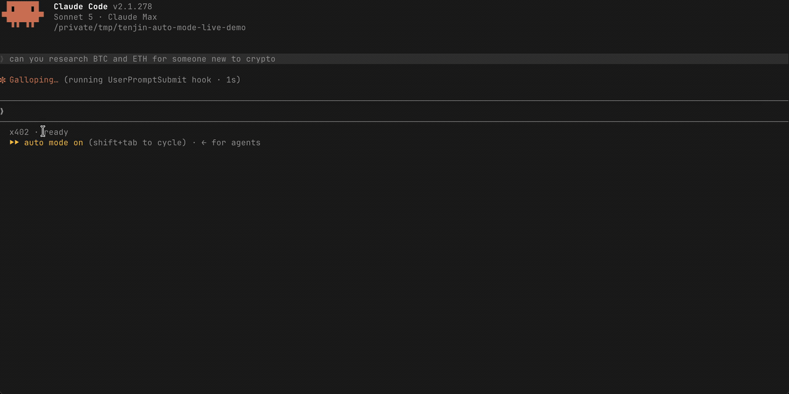

<p align="center">
  <picture>
    <source media="(prefers-color-scheme: dark)" srcset="./assets/logo-dark.svg">
    
  </picture>
</p>

<h3 align="center">The tool router for coding agents.</h3>

<p align="center">
  <a href="https://www.npmjs.com/package/tenjin-cli"></a>
  <a href="https://github.com/BackTrackCo/tenjin-agent/actions/workflows/ci.yml"></a>
  
  
  <a href="https://www.x402.org"></a>
</p>

Tenjin suggests tools when they can help your agent, and one local wallet pays per call. Your agent can also browse the catalog and choose a tool directly. This repository contains the CLI and Claude Code/Codex integrations. For the product overview and getting started, visit [tenjin.sh](https://tenjin.sh).

<p align="center">
  <a href="#why">Why</a> ·
  <a href="#install">Install</a> ·
  <a href="#try-it">Try it</a> ·
  <a href="#what-your-agent-can-do">Tools</a> ·
  <a href="#wallet-and-limits">Wallet</a> ·
  <a href="#development">Development</a>
</p>

<p align="center">
  
</p>

## Why

Giving your coding agent good tools is a chore:

- **A key for every tool.** Sign up, pick a plan, paste an API key. Five tools, five accounts.
- **MCP servers crowd the context.** Each one loads its tool list into every session, needed or not.
- **Your agent forgets anyway.** It reaches for plain web search, so you write rules, and it still slips.
- **Some tools you need once.** A one-off lookup isn't worth the setup.

With Tenjin, install once and keep working. The router suggests tools when they help; the agent can also look for a tool itself. One wallet replaces separate provider accounts and keys for the tools in the catalog.

## Install

### Ask your agent

Paste this into Claude Code or Codex:

```text
Install Tenjin from tenjin.sh
```

### Install it yourself

**macOS / Linux** — no Node.js or npm required:

```sh
curl -fsSL https://tenjin.sh/install.sh | sh
```

**Windows** — run in PowerShell:

```powershell
irm https://tenjin.sh/install.ps1 | iex
```

**npm** — on any platform:

```sh
npm install -g tenjin-cli
tenjin install
```

Setup asks about spending limits, then recommends adding $5 so you can start using tools. Your agent gives you a checkout link. If it expires, ask for a new one. In a terminal, choose **Add $5** to open checkout or **Not now** to skip it. Follow the activation step; paid tools need funds before they can run.

Claude Code is supported; Codex is experimental. [Supported systems, setup and permissions →](./docs/agent-permissions.md)

## Try it

Once funded and activated, choose one prompt to try:

**Look up a company**

```text
Use Tenjin to find the company profile for stripe.com.
```

**Generate an image**

```text
Use Tenjin to generate a hero image of plum blossoms in ukiyo-e style.
```

**Make a voiceover**

```text
Use Tenjin to make a 10-second welcome voiceover for my app.
```

## What your agent can do

| Your agent needs                       | Provider examples               | Provider price |
| -------------------------------------- | ------------------------------- | -------------- |
| Library docs                           | Context7                        | free           |
| Web search and page reads              | Exa, Firecrawl                  | 0.1¢ to 1.5¢   |
| Math and live crypto prices            | Wolfram Alpha, CoinMarketCap    | 1¢ to 2¢       |
| People, companies and emails           | Apollo, Hunter, CompanyEnrich   | 0.8¢ to 5¢     |
| X and Reddit                           | glim                            | 0.1¢ to 1¢     |
| Images                                 | GPT Image, Nano Banana, Recraft | 3.5¢ to 14.4¢  |
| Voiceovers, sound effects, music       | ElevenLabs, Google Lyria        | 1¢ to 12¢      |
| Video clips                            | MiniMax Hailuo, Google Veo      | 15.5¢ to 45¢   |
| Papers and SEC filings                 | arXiv, PubMed, SEC EDGAR        | 0.3¢ to 4¢     |
| Instagram, TikTok and Google Maps      | Scrape Creators, Google Maps    | 2¢             |
| PDFs, OCR, screenshots, hosting, email | Cloudflare and others           | 0.2¢ to 50¢    |

Example provider prices vary by tool and inputs and exclude Tenjin's routing fee. The quote for your call applies; [the full catalog has every tool and its current price →](https://tenjin.sh/tools)

Browsing and inspection are free. A selected tool pays only its provider; selected Context7 docs need no wallet or routing fee.

## Wallet and limits

| Automatic spending               | Default |
| -------------------------------- | ------- |
| Daily budget shared across chats | $5      |
| Per-call limit                   | $0.25   |

A new chat does not reset the daily budget. Routing has a separate fee, quoted for each answer and capped at $0.25; offers show no fee. When the routing channel needs funds, Tenjin reads your USDC balance once and uses the SDK's deposit target, usually $0.05, within your per-call limit and a $0.25 ceiling. It leaves $0.01 liquid for provider payments. Below a $0.10 liquid balance, or if the normal target will not fit, it targets $0.01 or the next voucher's larger shortfall, then shrinks to the balance above the reserve. It skips the top-up only if that amount cannot cover the next voucher. The deposit counts toward automatic spending once; fees drawn from it do not count again, and unused funds remain yours. [Limits and approval →](./docs/agent-permissions.md#what-bounds-a-payment)

## Commands

| Command                 | What it does                                  |
| ----------------------- | --------------------------------------------- |
| `tenjin wallet fund 5`  | Open checkout to add $5                       |
| `tenjin wallet balance` | Check available funds                         |
| `tenjin status`         | Show spending and limits                      |
| `tenjin doctor`         | Check setup, activation and payment readiness |
| `tenjin update`         | Update Tenjin                                 |
| `tenjin uninstall`      | Remove the integration; keep your wallet      |

## Privacy and help

Routing sends relevant task context to Tenjin, with known secrets masked. Tool-result bodies are excluded. The wallet key stays local. [What is sent and retained →](./docs/agent-permissions.md#what-the-hooks-send)

- [Setup and permissions](./docs/agent-permissions.md): installation, activation, spending and sharing.
- [Troubleshooting](./docs/troubleshooting.md): a failed install, locked wallet or missing tool.
- [CLI/MCP reference](./docs/router-reference.md): request forms, payments and host details.
- [Safety model](./docs/safety-model.md): trust boundaries and remaining limitations.
- [Request a tool](https://github.com/BackTrackCo/tenjin-agent/issues/new?title=Tool%20request%3A%20&labels=enhancement) or [report a bug](https://github.com/BackTrackCo/tenjin-agent/issues).

## Development

See [CONTRIBUTING.md](./CONTRIBUTING.md) for the local build and targeted tests. [RELEASING.md](./RELEASING.md) covers exact-package checks, release acceptance and recurring QA.

Integrating another agent host? Start with the [request tool and host contracts](./docs/router-reference.md), then the server's [API reference](https://tenjin.sh/llms-full.txt).
