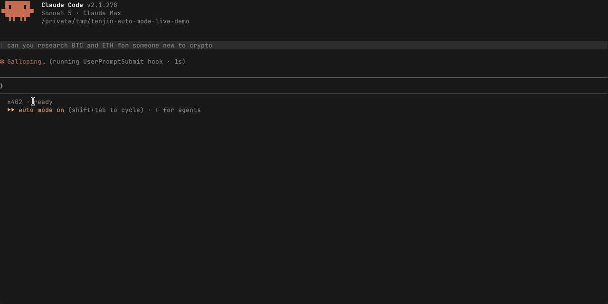

<p align="center">
  <picture>
    <source media="(prefers-color-scheme: dark)" srcset="./assets/logo-dark.svg">
    
  </picture>
</p>

<h3 align="center">The tool router for coding agents.</h3>

<p align="center">
  <a href="https://www.npmjs.com/package/tenjin-cli"></a>
  
  
</p>

<p align="center">
  <a href="#install">Install</a> ·
  <a href="#try-it">Try it</a> ·
  <a href="#what-your-agent-can-do">Tools</a> ·
  <a href="#wallet-and-limits">Wallet and limits</a> ·
  <a href="#request-a-tool">Request a tool</a>
</p>

<p align="center">
  
</p>

## Why

Giving your coding agent good tools is a chore:

- **A key for every tool.** Sign up, pick a plan, paste an API key. Five tools, five accounts.
- **MCP servers crowd the context.** Each one loads its tool list into every session, needed or not.
- **Your agent forgets anyway.** It reaches for plain web search, so you write rules, and it still slips.
- **Some tools you need once.** A one-off lookup isn't worth the setup.

With Tenjin, you install once and keep working. The router suggests the right tool when it helps, and your wallet pays per call. No keys, no extra servers, no rules.

## Install

Paste this into Claude Code:

```text
Install Tenjin from tenjin.sh
```

Your agent asks before it installs or spends anything, then sets everything up. Start a new Claude Code session, and the router is on.

Or from a terminal:

```bash
npm i -g tenjin-cli
tenjin install          # adds the plugin and creates your wallet
tenjin wallet fund 5    # optional: add $5 with a card, via Coinbase
```

Needs Claude Code 2.1.287+, and Node.js 22+ with npm to install. Install copies Tenjin, with its own Node, into `~/.tenjin/runtime` and puts the `tenjin` command in `~/.local/bin`, so switching or removing Node later doesn't stop it. Add `--project` to set it up for one project only.

**Codex (experimental):** run `tenjin install` in Codex or a terminal, and it sets up Codex too. [How it hooks in →](./docs/agent-permissions.md#codex)

## Try it

Work as usual. Ask for something your agent can't do on its own:

```text
> Generate a 10-second voiceover that says "Welcome to Tenjin"
> Make a whoosh sound effect for a page transition
> Make a hero image of plum blossoms in ukiyo-e style
> Make a 5-second video of a paper crane unfolding
> Summarize the risk factors in Nvidia's latest 10-K
> What are people on Reddit saying about Bun vs Node lately?
```

The router names the tool and its price, and your agent calls it.

## What your agent can do

| Your agent needs                       | With                            | Per call      |
| -------------------------------------- | ------------------------------- | ------------- |
| Library docs                           | Context7                        | free          |
| Web search and page reads              | Exa, Firecrawl                  | 0.1¢ to 1.5¢  |
| Math and live crypto prices            | Wolfram Alpha, CoinMarketCap    | 1¢ to 2¢      |
| People, companies and emails           | Apollo, Hunter, CompanyEnrich   | 0.8¢ to 15¢   |
| X and Reddit                           | glim                            | 0.1¢ to 1¢    |
| Images                                 | GPT Image, Nano Banana, Recraft | 0.1¢ to 14.4¢ |
| Voiceovers, sound effects, music       | ElevenLabs, Google Lyria        | 1¢ to 12¢     |
| Video clips                            | MiniMax Hailuo, Google Veo      | 15.5¢ to 45¢  |
| Papers and SEC filings                 | arXiv, PubMed, SEC EDGAR        | 0.3¢ to 4¢    |
| Instagram, TikTok and Google Maps      | Scrape Creators, Google Maps    | 2¢            |
| PDFs, OCR, screenshots, hosting, email | Cloudflare and others           | 0.2¢ to 50¢   |

We review every tool by hand. [Every tool and its current price →](https://tenjin.sh/tools)

## How it works

1. The router watches the moments a tool could help: your prompt, each web search or page fetch, each task handed to a subagent, and each question your agent asks you.
2. Jev, a decision model from [TypeSafe](https://typesafe.ai), picks one tool from the catalog, or none. Your agent sees one line naming the tool and its price.
3. Your agent calls it through the plugin's `request` tool, and your wallet pays the provider. When nothing fits, your agent carries on with its own tools.

The router sees your prompt and up to six earlier messages, with secrets masked, and never sees tool results. [What the hooks send →](./docs/agent-permissions.md#what-the-hooks-send)

## Wallet and limits

`tenjin install` creates a wallet on your machine that holds USDC on Base. Its key never leaves your machine, and Tenjin never holds your funds. Payments run over [x402](https://www.x402.org) ([whitepaper](https://www.x402.org/x402-whitepaper.pdf), [Coinbase docs](https://docs.cdp.coinbase.com/x402/welcome)).

| Limit    | Default | Change it                             |
| -------- | ------- | ------------------------------------- |
| Per day  | $5      | `tenjin config set sessionBudget 2`   |
| Per call | $0.25   | `tenjin config set maxAutoSpend 0.50` |

- A call over a limit pays nothing until you say yes. The per-call limit can't go below $0.25.
- Routing costs $0.003 a call, on top of the tool's price. $5 covers about 500 web searches, 130 images or 40 voiceovers.
- Add funds with `tenjin wallet fund 5`, or send USDC on Base to the address `tenjin wallet address` prints.

[How the limits and the fee work →](./docs/agent-permissions.md#what-bounds-a-payment)

The limits cap spending from your Tenjin balance.

## Your settings

Tell your agent what Tenjin may use. It runs `tenjin config`, and reports what was saved and how to undo it.

| You say                                     | Your agent runs                                             |
| ------------------------------------------- | ----------------------------------------------------------- |
| "Prefer Exa for web research."              | `tenjin config prefer --task "web research" --provider exa` |
| "Never use Firecrawl through Tenjin."       | `tenjin config block --provider firecrawl`                  |
| "Only use Tenjin for images."               | `tenjin config only --global --category images`             |
| "Run Tenjin's picks automatically for Exa." | `tenjin config replacement on --provider exa`               |
| "What have I changed?"                      | `tenjin config`                                             |
| "Reset my web research preference."         | `tenjin config reset --task "web research" --preference`    |

- Settings stay on this machine. A project's files can't add a rule.
- "Run Tenjin's picks automatically" is off by default. On, Claude Code with the Tenjin plugin runs Tenjin's pick in place of a web search or page fetch, within your limits.
- `tenjin config --help` lists every operation.

[What your settings cover, and the permissions to grant →](./docs/agent-permissions.md#your-settings-what-tenjin-may-use)

## Your accounts

Connect your own Apify, fal or Firecrawl account, and Tenjin uses it first for the jobs it does well there. Your own plan pays for those calls, and they don't count toward your Tenjin limits.

| You say                                | Your agent runs                                   |
| -------------------------------------- | ------------------------------------------------- |
| "Use my Apify account."                | `tenjin connect apify`                            |
| "Don't put Apify first."               | `tenjin config reset --source apify --preference` |
| "If Apify refuses, use Tenjin's tool." | `tenjin config fallback on --source apify`        |
| "Disconnect Apify."                    | `tenjin disconnect apify`                         |
| "What did my accounts do this week?"   | `tenjin usage`                                    |

- You approve the sign-in in your browser. Where no browser can open, run `tenjin connect <name> --paste` in your own terminal and type the key at its hidden prompt. Never paste a key into a chat.
- The sign-in stays encrypted on this machine, with its key in your OS keychain.
- When your account refuses a call (its sign-in expired, or its plan or rate limit ran out), Tenjin stops, says why, and offers its own tool for the job with its price.
- Any MCP server connects by its address: `tenjin connect https://mcp.example.com/mcp`. Tenjin runs it only when you ask for it by name, and says it hasn't checked it.

## Commands

```bash
tenjin status                          # your balance, spent today, your limits and your accounts
tenjin usage                           # what lookups cost, by day, from your balance and on your accounts
tenjin wallet balance                  # what's left
tenjin payments                        # paid lookups from this machine
tenjin doctor                          # check that a lookup can run
tenjin update                          # newest version now (it also updates itself daily; `tenjin config set update.mode off` stops that)
tenjin config set router.enabled false # pause the router
tenjin uninstall                       # run before `npm uninstall -g`; your wallet stays
```

## Request a tool

Tenjin is in alpha, and the catalog grows with what people ask for.

- **[Request a tool →](https://github.com/BackTrackCo/tenjin-agent/issues/new?title=Tool%20request%3A%20&labels=enhancement)**
- **[Report a bug →](https://github.com/BackTrackCo/tenjin-agent/issues/new?labels=bug)**

## Learn more

- [Permissions, hooks, and what install writes](./docs/agent-permissions.md)
- [Safety model](./docs/safety-model.md)
- [Troubleshooting](./docs/troubleshooting.md)
- [Contributing](./CONTRIBUTING.md)
